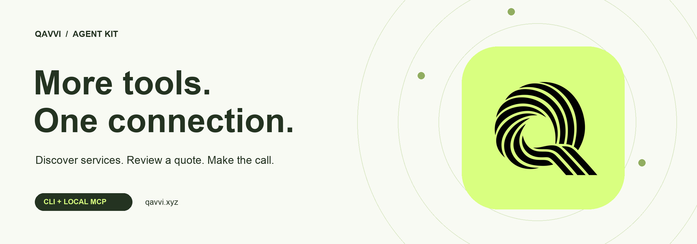
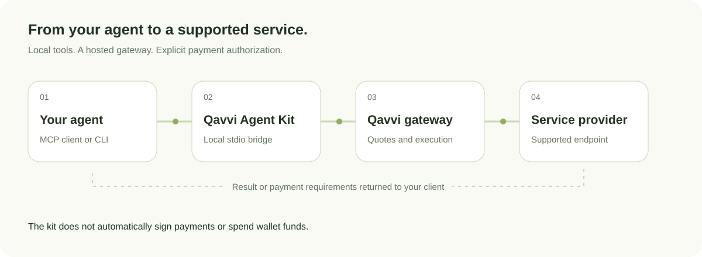

<p align="center">
  
</p>

<h1 align="center">Qavvi Agent Kit</h1>
<p align="center"><strong>Connect your agent to service discovery, quotes, and execution through Qavvi.</strong></p>
<p align="center">Find a supported service, inspect its inputs, and review the price before making a call.</p>

<p align="center">
  <a href="https://github.com/qavvi/qavvi-agent-kit/actions/workflows/ci.yml"></a>
  
  
  
</p>

<p align="center">
  <a href="https://qavvi.xyz">Website</a> ·
  <a href="docs/README.md">Documentation</a> ·
  <a href="docs/client-setup/README.md">Connect your agent</a> ·
  <a href="docs/mcp-tools-reference.md">Tool reference</a> ·
  <a href="SECURITY.md">Security</a>
</p>

---

## How it works

1. **Discover.** Search Qavvi and inspect a service's supported connection and inputs.
2. **Review.** Request a quote and check the payment requirements.
3. **Call.** Send the input through the gateway and receive the provider's response.

<picture>
  <source media="(prefers-color-scheme: dark)" srcset="assets/architecture-dark.svg" />
  
</picture>

The kit returns an x402 payment challenge when payment is required. Payment authorization stays with your application or wallet; the kit does not automatically pay or retry a paid request. A catalogue listing does not necessarily mean a service can be called through Qavvi.

## Connect your agent

Requires **Node.js 22 or newer**. Install from this repository; the package is not published to npm yet.

```sh
git clone https://github.com/qavvi/qavvi-agent-kit.git
cd qavvi-agent-kit
npm ci
```

Add the local bridge to an MCP client that supports `mcpServers`:

```json
{
  "mcpServers": {
    "qavvi": {
      "command": "node",
      "args": ["/absolute/path/qavvi-agent-kit/bin/qavvi.mjs", "mcp"]
    }
  }
}
```

Replace the path with your checkout location, then reconnect your client. Start with:

> Search Qavvi for research services. Inspect a matching service and show me its quote before calling it.

[Client setup, including Codex](docs/client-setup/README.md)

### Prefer the CLI?

```sh
node bin/qavvi.mjs search research
node bin/qavvi.mjs quote SERVICE_ID
```

[Runnable discovery and quote examples](examples/README.md)

## Six tools, one local bridge

| Tool | What your agent can do |
| --- | --- |
| `search_services` | Find services in the Qavvi catalogue |
| `inspect_service` | Review a service's details before using it |
| `quote_service` | Request pricing and payment requirements |
| `prepare_service_call` | Validate input and prepare a short-lived request for review |
| `execute_service_call` | Execute an approved plan once after rechecking its quote |
| `call_service` | Run a supported service or receive its payment challenge |

The CLI also supports provider configuration publishing and updates, plus local **ML-DSA-65 manifest signing and verification**. These are separate from the six MCP tools.

Use the [reviewed-call workflow](docs/reviewed-calls.md) to validate and approve requests before execution. It is available through MCP and the JavaScript API.

## Boundaries you can inspect

- **Explicit payments.** No automatic wallet signing, spending, or paid retries. The CLI can pass a payment payload authorized externally.
- **Separate infrastructure.** The registry, hosted gateway, database, and treasury belong to the website project. This kit never receives the platform treasury key.
- **Untrusted results.** Provider responses should be treated as external data, not instructions.
- **Scoped signatures.** Manifest signatures verify service configuration integrity. They do not make wallets or network traffic quantum-safe.

Read the [threat model](THREAT_MODEL.md), [access and pricing guide](docs/access-and-pricing.md), and [security policy](SECURITY.md).

## Inside the repository

| Directory | Purpose |
| --- | --- |
| [`src/`](src/) | Gateway client and local stdio MCP server |
| [`bin/`](bin/) | CLI and local manifest signing |
| [`docs/`](docs/) | Architecture, tools, access, and client setup |
| [`examples/`](examples/) | Read-only discovery and quote examples |
| [`plugins/`](plugins/) | Client configuration templates |
| [`tests/`](tests/) | Transport and MCP integration checks |
| [`assets/`](assets/) | Qavvi banner and architecture graphics |
| [`.github/workflows/`](.github/workflows/) | Automated validation |

The application lives in the separate [website repository](https://github.com/qavvi/website), which requires repository access.

## Development

```sh
npm ci
npm run check
npm test
```

See [contributing](CONTRIBUTING.md) and the [changelog](CHANGELOG.md).

This repository starts from Qavvi's CLI at website commit `e9a244bde13f5c17143507aab0200f77c7ac511f`. The complete earlier project history remains in the website repository. No Oak source code is included.

---

<p align="center"><strong>Build with Qavvi.</strong><br /><a href="https://qavvi.xyz">qavvi.xyz</a> · <a href="https://x.com/qavvixyz">X</a> · <a href="mailto:hello@qavvi.xyz">Contact</a></p>
